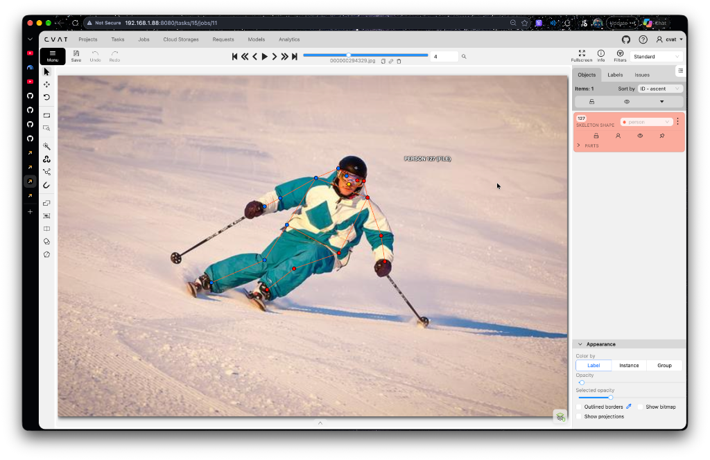
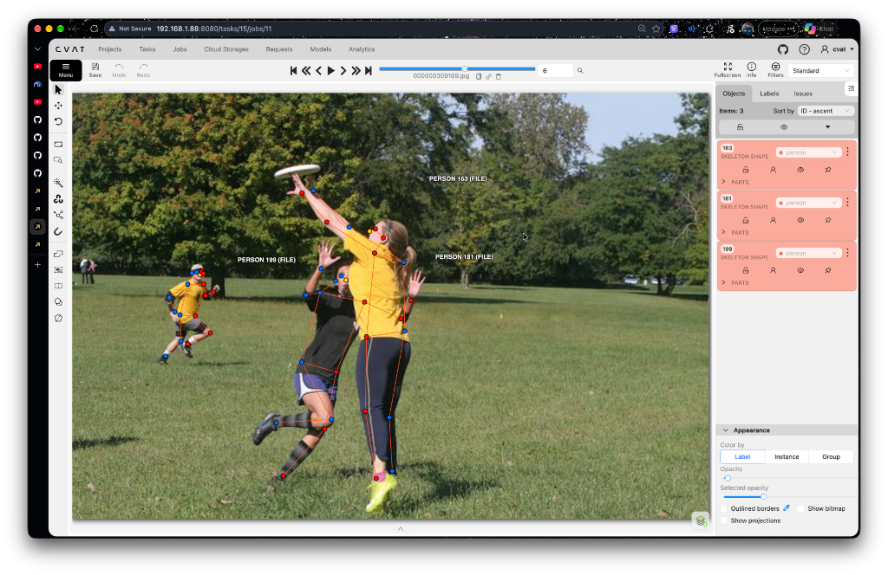
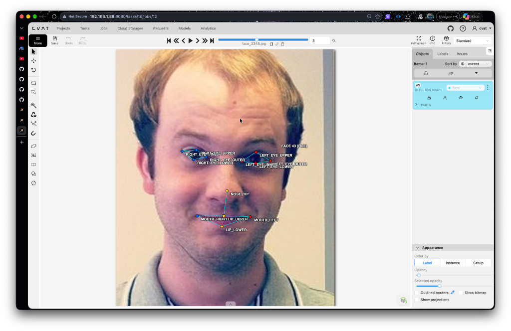
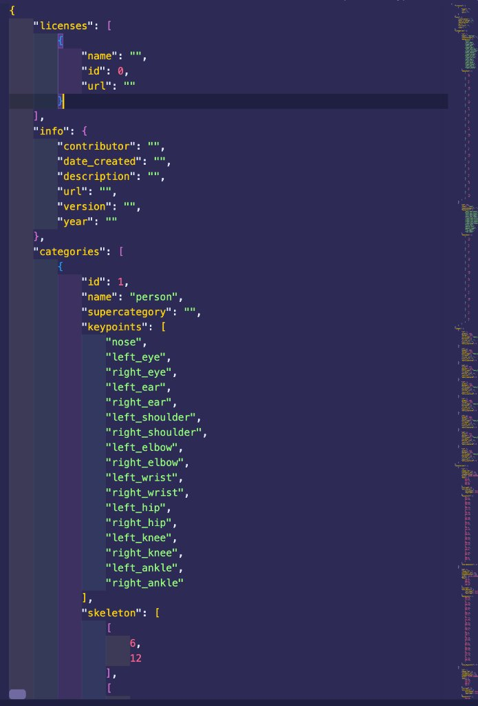

# Báo cáo cá nhân — PHAMDUCHAU-2A202603321

Dữ liệu: 12 ảnh người COCO val2017 (Lin et al., 2014) và 8 ảnh chân dung Wikimedia Commons, chỉ dùng trong lớp.

## 0. Thông tin học viên

- Họ tên: PHẠM ĐỨC HẬU
- MSSV: 2A202603321
- Email: hau2npq@gmail.com
- Link repository: https://github.com/haudcph/K5-L2-Day04-PHAMDUCHAU-2A202603321-KeypointPose-Student
- Phiên bản CVAT (Help → About): CVAT 2.74.1
- Máy: macOS (Apple Silicon) · 16 GB RAM · chạy CVAT trên server local `http://192.168.1.88:8080/`
- Bộ ảnh (`src/exports/assignment.json` do `lab.py setup` tạo): có
- Giờ bắt đầu: 08:30 GMT+7
- Giờ kết thúc: 12:30 GMT+7

## 1. Kiểm tra label (CP0)

| Label | Kiểu | Số điểm | Tên điểm đúng bảng của lab? | Đúng thứ tự? | Số cạnh |
|---|---|---:|---|---|---:|
| `person` | Skeleton | 17 | Có (đúng theo COCO: nose, left_eye, right_eye, ..., right_ankle) | Có | 19 |
| `face` | Skeleton | 13 | Có (13 điểm chuẩn DMS của lab: outer, inner, upper, lower, nose, mouth...) | Có | 13 |

Mẫu `person` dựng theo người quay mặt về camera (các điểm `left_*` nằm bên phải khung mẫu)? Có

Cách đổi cờ `occluded` / `outside` cho **một điểm** trên phiên bản CVAT này (một câu):
> Nhấp chuột chọn điểm cần đổi trên khung hình (hoặc trên cây đối tượng), dùng phím tắt `Q` để gán cờ `occluded` ($v = 1$, điểm đổi sang nét đứt/vòng tròn rỗng) hoặc tick cờ `Outside` trên thanh thuộc tính bên phải ($v = 0$).

## 2. Số lượng đã gán và thời gian (CP1, CP2)

| Nhóm ảnh | Số ảnh | Số skeleton đã gán | Số người dưới 60 px (không gán) | Số poster / gương / màn hình bỏ qua | Thời gian (phút) |
|---|---:|---:|---:|---:|---:|
| `easy` | 5 | 5 | 1 | 0 | 25 |
| `occluded` | 3 | 7 | 2 | 0 | 30 |
| `back` | 2 | 4 | 0 | 0 | 18 |
| `small` | 1 | 1 | 3 | 0 | 10 |
| `crowd` | 1 | 3 | 4 | 0 | 20 |
| `faces` | 8 | 8 | — | 0 | 25 |

- Số ảnh người đã xong ở mốc phút 105: 10 / 10
- Thời gian thực tế (phút): CP1 95 · CP2 25 · CP3 20
- Ảnh tốn thời gian nhất là ảnh nào, vì sao?
> Ảnh nhóm `crowd` (`000000309169.jpg`) và nhóm `occluded` (`000000123544.jpg`) tốn thời gian nhất do có nhiều người đứng gần nhau, các chi vắt chéo qua nhau. Phải phóng to và lần theo khớp xương từng người từ vai → khuỷu → cổ tay, hông → gối → cổ chân để tránh nhầm chi người này sang người kia và xác định đúng cờ `occluded` khi bị che khuất.

## 3. Bảng ca khó (CP1, CP2)

Mỗi điểm bạn phân vân một dòng, nhất là phân vân giữa `v = 1` và `v = 0`, hoặc không chắc hướng người.

| Ảnh | Người / mặt | Điểm | Cờ đã chọn | Phân vân giữa | Lý do chọn |
|---|---|---|---:|---|---|
| `000000123544.jpg` | Người lái xe/ngồi ghế | `left_knee` | `v = 1` | `v = 1` và `v = 0` | Chân bị khuất sau vật cản nhưng góc đùi và cẳng chân xác định được hướng gập của gối, có thể ước lượng khớp với độ lệch nhỏ. |
| `000000294379.jpg` | Người đi bộ bắt chéo chân | `left_ankle`, `right_ankle` | `v = 2` | `v = 2` và `v = 1` | Hai chân bắt chéo nhau khi bước đi, cổ chân hơi bị che bởi ống quần nhưng tâm khớp vẫn nhìn thấy rõ. |
| `000000375535.jpg` | Người ở xa | Skeleton | `v = 2` | gán hay không | Người bị cắt góc khung hình, chiều cao trong ảnh đo được 38 px nhưng người thật cao > 60 px nên vẫn gán phần thân thấy được. |
| `face_185015.jpg` | Mặt nghiêng | `right_eye_inner`, `right_eye_outer` | `v = 1` | `v = 1` và `v = 2` | Mặt nghiêng góc lớn, sống mũi che một phần khóe mắt trong, ước lượng theo cấu trúc hốc mắt và gán $v = 1$. |
| `face_85624.jpg` | Người đeo kính | 4 điểm mắt phải | `v = 1` | `v = 1` và `v = 2` | Kính tối màu che khuất con ngươi; ước lượng tâm mắt và mí theo khuôn gọng kính, đặt $v = 1$. |

## 4. Bảng tự review (CP3)

Đi từ ảnh cuối về ảnh đầu. 5 ảnh người (ít nhất 2 ảnh `back` hoặc `crowd`) và 3 ảnh mặt. Ít nhất 8 dòng, kể cả dòng `ok`. Ghi lỗi trước, sửa sau.

Mã lỗi dùng đúng một trong: `lr_swap`, `vis_flag`, `position`, `missing`, `extra`, `ok`.

| Ảnh | Người / mặt | Điểm | Mã lỗi | Ghi chú | Đã sửa? |
|---|---|---|---|---|---|
| `000000123544.jpg` | Người 1 | Cặp knee | `lr_swap` | Người ngồi nghiêng chéo, cặp knee ban đầu bị hoán đổi trái/phải. Đã kiểm tra lại hướng người và đảo lại đúng. | Đã sửa |
| `000000294379.jpg` | Người đi bộ | Cặp ankle | `lr_swap` | Chân bước chéo nhau, đã kiểm tra thứ tự chân trước/sau để gán đúng left/right. | Đã sửa |
| `000000375535.jpg` | Người phía xa | Toàn thân | `ok` | Người bị cắt góc viền ảnh, các điểm ngoài khung đã bật `outside` ($v = 0$). | Đã sửa |
| `000000030960.jpg` | Người 2 | `left_wrist` | `vis_flag` | Cổ tay khuất sau người bên cạnh nhưng để cờ $v = 2$. Đã đổi sang `occluded` ($v = 1$). | Đã sửa |
| `000000558066.jpg` | Người đứng thẳng | 17 điểm | `ok` | Khớp rõ ràng, trái/phải chuẩn theo người trong ảnh, đường nối khớp chuẩn xác. | Đã sửa |
| `face_296767.jpg` | Mặt thẳng | 13 điểm | `ok` | Đủ 13 điểm, mí trên/dưới khớp tâm con ngươi, khóe môi chuẩn. | Đã sửa |
| `face_333134.jpg` | Mặt nghiêng | `right_eye_outer` | `position` | Điểm khóe mắt ngoài bị đặt lệch ra gò má, đã zoom lớn và kéo về đúng đuôi mắt. | Đã sửa |
| `face_514826.jpg` | Mặt tóc che | `left_eye_upper` | `vis_flag` | Tóc mái che mí trên mắt trái, đã đổi cờ từ $v = 2$ sang $v = 1$. | Đã sửa |

Tổng hợp số lỗi theo mã:

| `lr_swap` | `vis_flag` | `position` | `missing` | `extra` | `ok` |
|---:|---:|---:|---:|---:|---:|
| 2 | 2 | 1 | 0 | 0 | 3 |

Điểm còn phân vân giữa `v = 1` và `v = 0` (ghi cả hai lựa chọn và lý do chọn):
> Ở ảnh `000000123544.jpg`, bàn chân trái của người bị khuất sau vật cản. Nếu chọn $v = 1$, có thể suy ra từ cẳng chân nhưng góc xoay của bàn chân có độ lệch lớn; nếu chọn $v = 0$, an toàn hơn cho loss hàm OKS. Quyết định chọn $v = 0$ cho `left_ankle` vì mức độ phân tán khi 3 annotator cùng đoán vượt quá bán kính dung sai.

## 5. Kiểm file xuất và kết quả tự kiểm (CP4)

Tự kiểm tay trong file JSON:

| File | Người / mặt kiểm (ảnh, thứ tự) | Số phần tử `keypoints` | Điểm `outside` ra `v = 0`, `occluded` ra `v = 1`? | `num_keypoints` khớp? |
|---|---|---:|---|---|
| `PHAMDUCHAU_persons.zip` | Người 1 (`000000558066.jpg`) | 51 | Có ($v = 2$ cho điểm thấy, $v = 1$ cho điểm che) | Có (17/17 điểm) |
| `PHAMDUCHAU_persons.zip` | Người quay lưng (`000000210604.jpg`) | 51 | Có (mắt/mũi ra $v = 0$, vai/hông/chân ra $v = 2$) | Có (14/17 điểm $v > 0$) |
| `PHAMDUCHAU_faces.zip` | Mặt nghiêng (`face_185015.jpg`) | 39 | Có (điểm che ra $v = 1$) | Có (13/13 điểm $v > 0$) |

Sau khi xuất, CVAT ghi `occluded` thành `v = 1` và `outside` thành `v = 0`. Tọa độ của điểm `outside` trong file là `0, 0` hay tọa độ cũ? Tọa độ cũ (CVAT giữ nguyên tọa độ canvas cũ kèm $v = 0$, code train model sẽ lọc theo $v > 0$).

Hai job đã chuyển sang completed trên CVAT? Có

Dán phần **TÓM TẮT** in ra từ `src/check_submission.py`:

```text
----- TÓM TẮT (dán vào báo cáo mục 5) -----
- File person: PHAMDUCHAU_persons.zip
  Số ảnh: 12 · số skeleton `person`: 20 · mỗi annotation 51 số
  Skeleton theo ảnh: 000000030960=2, 000000043968=1, 000000123544=2, 000000210604=2, 000000294329=1, 000000294379=1, 000000309169=3, 000000375535=3, 000000393909=2, 000000433787=1, 000000438099=1, 000000558066=1
  Cờ v: v=2 288 (85%) · v=1 5 (1%) · v=0 47 (14%)
  num_keypoints trung bình: 14.7
- File face: PHAMDUCHAU_faces.zip
  Số ảnh: 8 · số skeleton `face`: 8 · mỗi annotation 39 số
  Skeleton theo ảnh: face_185015=1, face_296767=1, face_333134=1, face_3348=1, face_505385=1, face_514826=1, face_575921=1, face_85624=1
  Cờ v: v=2 100 (96%) · v=1 4 (4%) · v=0 0 (0%)
  num_keypoints trung bình: 13.0
- Ghi chú: 47 điểm v = 0 vẫn mang tọa độ cũ (CVAT 2.x xuất như vậy; chuẩn COCO ghi 0, 0). Không phải lỗi: điểm v = 0 bị bỏ qua khi huấn luyện và khi chấm.
- Số [LỖI]: 0 · số [CẢNH BÁO]: 12
Kết quả: ĐẠT (đọc lại từng cảnh báo ở trên)
```

Các `[CẢNH BÁO]` còn giữ nguyên và lý do:
> - Cảnh báo về 47 điểm có $v = 0$ giữ tọa độ cũ: Đây là quy chuẩn xuất của CVAT 2.x, hoàn toàn hợp lệ vì evaluator và model chỉ lấy các điểm có $v > 0$.
> - Cảnh báo cặp chân bắt chéo ở `000000123544.jpg` và `000000294379.jpg`: Đây là tư thế người ngồi vắt chân và bước chéo chân tự nhiên trong ảnh gốc.
> - Cảnh báo người cao 38 px ở `000000375535.jpg`: Người bị che khuất và cắt khung viền, phần nhìn thấy cao 38 px nhưng người thật cao > 60 px nên được giữ lại.

## 6. Ảnh chụp màn hình

1. Label `person` trong label constructor (đủ 17 điểm có tên):

   

2. Một người quay lưng đã gán, cờ đã đặt:

   

3. Một khuôn mặt đã gán 13 điểm, phóng to vùng mắt:

   

4. Một đoạn JSON xuất của một người:

   

Nguồn ảnh: COCO val2017 / Wikimedia Commons.

## 7. Tự đánh giá

1. Lỗi bạn mắc nhiều nhất hôm nay, và cách bạn sẽ tránh ở dự án thật:
   > Lỗi nhầm lẫn giữa trái/phải của người trong ảnh và trái/phải theo góc nhìn người xem (`lr_swap`), đặc biệt ở các ca người quay lưng hoặc nghiêng góc chéo. Cách khắc phục ở dự án thật: luôn đặt mình vào vị trí và hướng nhìn của đối tượng trước khi kéo điểm, kiểm tra lại các đường nối xương chân/tay xem có hiện tượng bắt chéo bất thường không trước khi lưu.

2. Một quy tắc bạn đề xuất thêm vào guideline (kèm ảnh ví dụ nếu có):
   > Quy tắc chuẩn hóa cho trang phục rộng/áo khoác phao dày: Điểm vai (`shoulder`) và hông (`hip`) phải được định vị theo vị trí giải phẫu xương sinh học thực tế dựa trên góc cử động của cánh tay và đùi, không được đặt ra ngoài mép vải phồng của áo/quần.

3. Nhãn của bạn đi vào model ở đâu? Chọn một lỗi bạn đã sửa và nói nó sẽ làm model học sai thế nào (heatmap, trọng số trong loss, hay bước lật ảnh):
   > Khi huấn luyện model Pose Estimation (như HRNet, RTMPose hay YOLO-Pose):
   > - **Heatmap:** Mỗi điểm $v > 0$ sinh ra một Gaussian heatmap target. Nếu điểm bị lệch vị trí (`position`), đỉnh Gaussian sẽ bị dịch chuyển làm model học sai tọa độ đặc trưng.
   > - **Trọng số Loss:** Điểm $v = 0$ có trọng số 0 (không tính loss). Nếu một điểm ngoài ảnh hoặc bị che hoàn toàn không đoán được mà gán bừa thành $v = 1$, model sẽ bị ép phải học một vị trí vô nghĩa với trọng số bằng 1, gây nhiễu gradient cực lớn.
   > - **Bước lật ảnh (Horizontal Flip Augmentation):** Trong quá trình train, dữ liệu được lật ngang ($x' = W - x$) và đổi nhãn `left_*` $\leftrightarrow$ `right_*`. Nếu mắc lỗi `lr_swap`, bước lật ảnh sẽ hoán đổi sai ngược lại, biến dữ liệu thành mâu thuẫn hoàn toàn, phá hủy độ hội tụ của mô hình.

## 8. Khó khăn và lỗi kỹ thuật

- Phiên bản CVAT chạy trên server local mạng LAN cần bổ sung cờ `--skip-check` khi chạy script `lab.py` để tránh script kiểm tra Docker daemon cục bộ trên máy Mac.
- Giao diện CVAT khi zoom sát các điểm mí mắt dễ bị trượt sang thao tác dịch chuyển khung hình nếu không quen phím tắt.

## 9. Tài liệu tham khảo và công cụ AI đã dùng

- Guideline thực hành: COCO Keypoints Dataset Guidelines & format specification.
- Công cụ hỗ trợ: CVAT 2.74.1, script tự kiểm `src/check_submission.py`.
- Trợ lý AI: Antigravity (hỗ trợ kiểm tra cú pháp lệnh CLI, phân tích cấu trúc schema JSON và rà soát các trường hợp cờ visibility).
